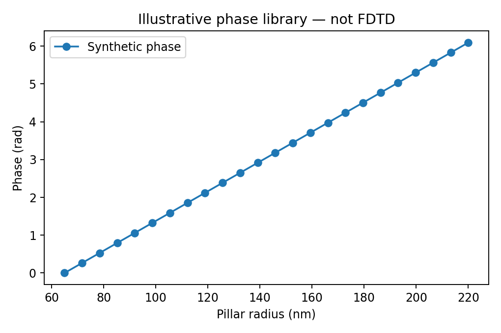
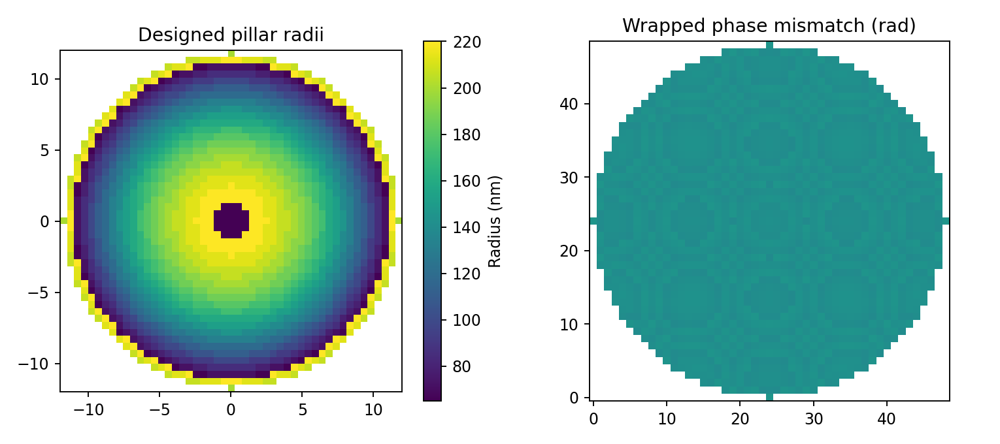
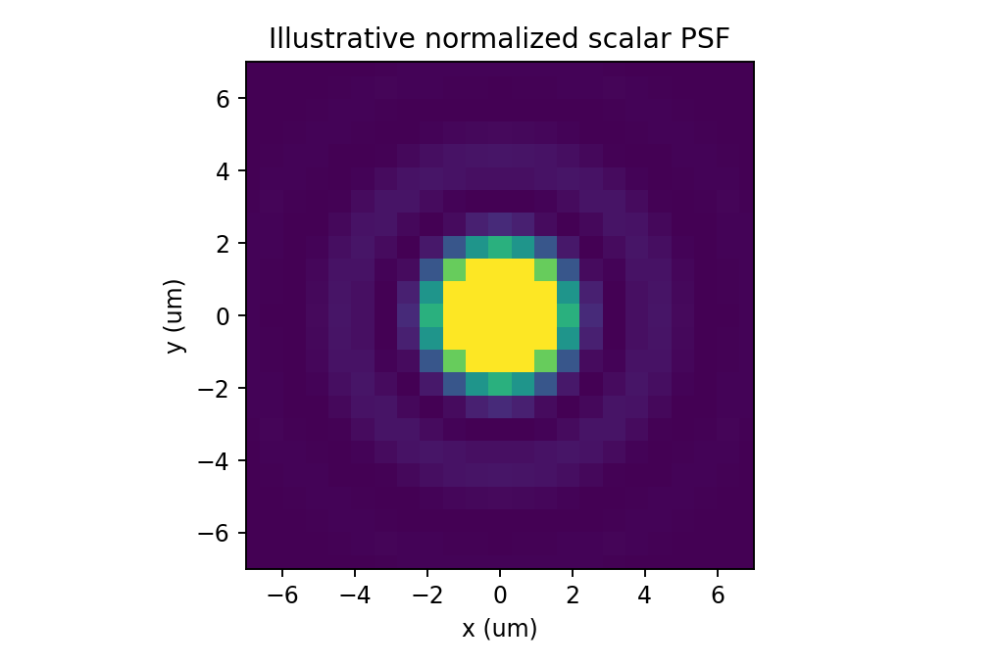

# Python–Lumerical Metalens Simulation and Post-Processing Portfolio

**Forouzan Habibighahfarokhi**

A computational optics portfolio presenting research-script examples alongside a small, runnable numerical demonstration of phase-library metalens design.

## Explore the project

| Component | Contents | Execution |
|---|---|---|
| [Research examples](research_scripts/README.md) | Python/lumapi field extraction, Lumerical projection, focal characterization and MAT export | Requires external Lumerical installation and simulation inputs; included for inspection |
| [Numerical core](src/metalens_portfolio/core.py) | Hyperbolic target phase, wrapped phase matching, residual-phase pupil and scalar Fourier intensity | Runs without Lumerical |
| [Demo](examples/run_demo.py) | Synthetic phase library, radius layout and focal intensity figures | Runs without Lumerical |
| [Tests](tests/test_core.py) | Phase wrapping, symmetry, pupil masking, central peak and Airy-width regression | Runs without Lumerical |

## Standalone demo

From this directory, with Python installed:

```bash
python -m pip install -r requirements.txt
python examples/run_demo.py
python -m pytest -q
```

The demo uses wavelength 1550 nm, radius 12 micrometers, pitch 500 nm and focal length 40 micrometers. The lookup table is **synthetic**, not electromagnetic simulation data. Element selection minimizes wrapped phase mismatch; it is not a numerical optimization algorithm.

| Synthetic phase library | Radius layout | Scalar focal intensity |
|---|---|---|
|  |  |  |

## Scope and interpretation

The scalar demo analytically removes the target focusing phase and transforms a residual-phase pupil. It is an illustrative focal-plane approximation, not full-vector propagation of a physical high-NA metalens. Each intensity map is peak-normalized; it does not report Strehl ratio, absolute throughput or focusing efficiency. FDTD files and real simulation results are not included. No coronagraph, high-contrast imaging or validated Zernike analysis is claimed.

The research examples are preserved for inspection, with their execution dependencies and exploratory calculations documented in their own README. They are not required to run the demo.

## Numerical checks

The FFT zero-padding arrangement was corrected and figures regenerated. For the ideal circular pupil at the demo settings, the four-times-sampled FWHM is approximately 2.685 micrometers, compared with the paraxial Airy estimate of 2.656 micrometers. This checks the demo's scalar calculation, not an FDTD simulation. Phase mismatch is reported as root-mean-square error.

## Publishing from VS Code

Open this folder (the one containing this README), initialize a Git repository in Source Control, stage the files and commit. Then use **Publish to GitHub**. Choose public for a portfolio visible to reviewers, or private for restricted access. Do not upload the ZIP itself as the project source.
